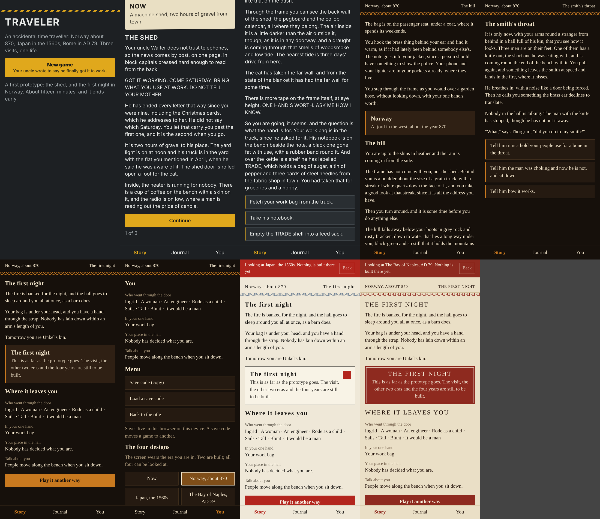

# Traveler (working title)

An accidental time traveller: Norway about 870, Japan in the 1560s, Rome in AD 79. Three visits, one life.

Status, 2026-11-24: **the prototype plays the whole Norway visit.** Character
creation, the shed, and three days in a hall on a fjord, up to the door to the
next place: ten choices of three roads each, about forty minutes. The screen
wears a different design in each era; Japan and Rome have a design and no
scenes yet. `docs/STATUS.md` says where the build stands, `docs/STORY.md` what
the story is, and `docs/DESIGN.md` what was built and measured.



## Play as an app

Once the Pages workflow has run on the default branch: open
https://heirsofruin.github.io/Traveler/ on a phone and choose Install (Chrome)
or Share → Add to Home Screen (Safari). It plays with the network off. Saves
live in that browser; Menu → Copy a save code moves a game anywhere.

## Run

```
npm install
npm run dev          # Vite dev server
npm run build        # dist/ (installable, build id stamped)
```

## Check

```
npm run check     # content, typecheck, build, tests, the Gate B model's invariants, validate, style lint, continuity, render scan, a 100-story bot batch, the site check, the phone smoke test
```

Must pass before every commit.

## Instruments

| Command | Question |
|---|---|
| `npm test` | Is it true? Creation, the prototype's rules, the save contract |
| `npm run validate` | Do the scenes link, and does every choice offer three roads? |
| `npm run audit` | Does every choice do something? |
| `npm run lint:style` | Does the prose break the style guide's lists? |
| `npm run transcript` | Scripted playthroughs as Markdown, in `docs/playthroughs/` |
| `npm run bot -- --runs 200` | Does every hero reach an ending? |
| `npm run smoke` | Does the real page work at 390px? |
| `npm run gate` | The Gate B tables (the numbers model, not the game) |

## Layout

```
content/              YAML scenes, registries, creation.yaml, eras.yaml, the style guide
src/content/          schema (Zod) and the compiled bundle
src/game/             this game's rules: creation, the module, saves
src/ui/               Preact screens and the four era designs (eras.css)
packages/engine/      the story engine, copied from Game-Workshop, not edited here
prototypes/killgate/  the Gate B numbers model
tools/, tests/        build, bot, smoke, validators; Vitest
docs/                 SPEC, STATUS, DESIGN, GATE-A, KILLGATE, HISTORY, playthroughs
```

## Sources
<!-- Real figures and their sources; "rounded for a game, do not cite". -->
